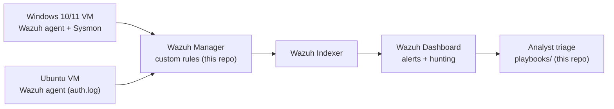

# Wazuh SOC Lab

A home Security Operations Center built on the open-source **Wazuh** SIEM. It collects logs from a
Windows and a Linux endpoint, raises alerts with custom detection rules, and pairs every rule with a
triage playbook, which is the same alert → investigate → respond loop a Tier-1 SOC analyst works.

## Architecture



All machines run on a host-only network. Nothing is exposed to the internet.

## Custom detections

| Rule ID | Detects | Source | MITRE ATT&CK | Playbook |
|---|---|---|---|---|
| 100100 | SSH brute force (8+ failures from one IP in 2 min) | Linux auth.log | T1110.001 | [ssh-brute-force](playbooks/ssh-brute-force.md) |
| 100101 | Successful SSH login after a brute-force burst | Linux auth.log | T1110 / T1078 | [ssh-brute-force](playbooks/ssh-brute-force.md) |
| 100110 | New local user account created | Windows Security 4720 | T1136.001 | [new-local-account](playbooks/new-local-account.md) |
| 100111 | User added to local Administrators group | Windows Security 4732 | T1098 | [new-local-account](playbooks/new-local-account.md) |
| 100120 | Suspicious PowerShell (download / encoded command) | PowerShell 4104 | T1059.001 | [suspicious-powershell](playbooks/suspicious-powershell.md) |

Rules live in [`rules/local_rules.xml`](rules/local_rules.xml).

## Getting started

Follow [`docs/setup.md`](docs/setup.md) to deploy Wazuh with the official single-node Docker setup,
enrol the agents, and load the custom rules.

## Repository layout

```
wazuh-soc-lab/
├── docs/setup.md            # deploy Wazuh, enrol agents, load rules
├── rules/local_rules.xml    # custom detection rules (IDs 100100+)
└── playbooks/               # one triage playbook per alert type
```

## Roadmap

- [x] Lab design and custom rule set
- [x] Triage playbooks for each rule
- [ ] Screenshots of each alert firing in my lab
- [ ] Forward alerts to [BlueShield](https://github.com/Pzycokid/blueshield) for automated enrichment
- [ ] Add Sysmon-based rules for persistence techniques

## Author

**Likhith H S**, M.Sc. Cyber Security, NFSU Goa · CEH · CCNA ·
[LinkedIn](https://www.linkedin.com/in/LikhithHS15)
